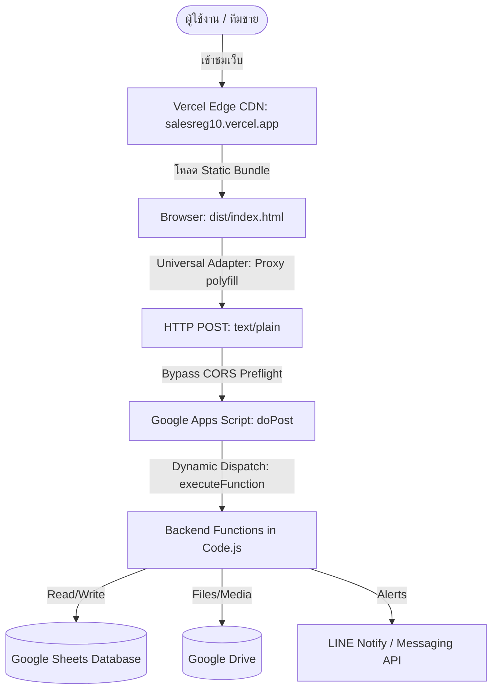
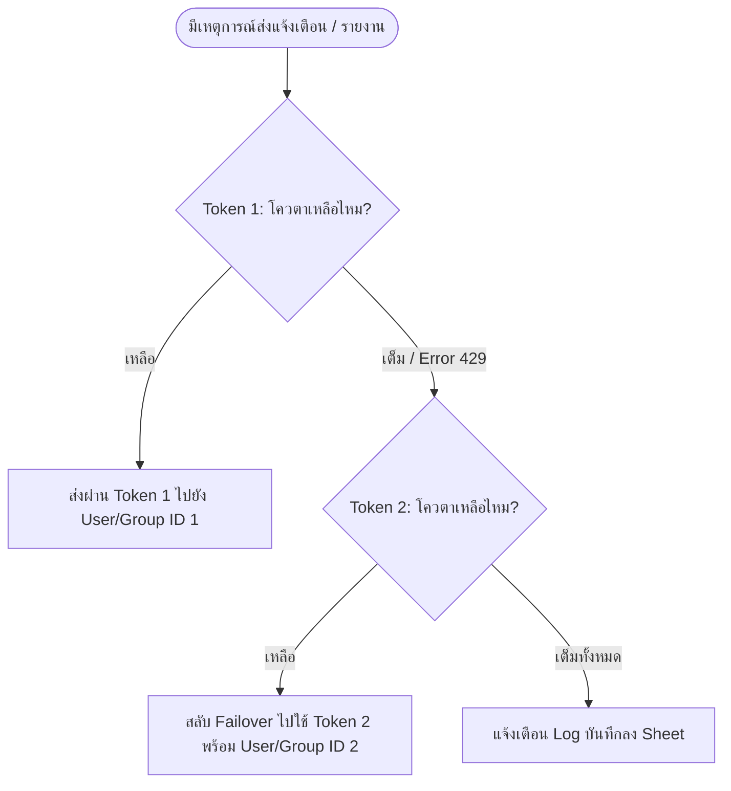

# Project Context: THP Sales Team Reg.10
# สถาปัตยกรรม เทคนิค และคู่มือมาตรฐานการพัฒนา (Architecture, Skills & Guidelines)

เอกสารรวบรวมข้อมูลสถาปัตยกรรม สไตล์การพัฒนา กฎระเบียบ เทคนิคเฉพาะตัว และคู่มือการ Deploy สำหรับระบบ **THP Sales Team Reg.10 (CRM)** เพื่อเป็น **Single Source of Truth** สำหรับทั้งทีมนักพัฒนาและ AI Agent

---

## 1. ภาพรวมระบบและสถาปัตยกรรม (System Overview & Architecture)

- **ประเภทระบบ**: CRM (Customer Relationship Management) สำหรับบริหารจัดการทีมขาย ข้อมูลการเข้าพบลูกค้า ยอดรายได้สะสม และระบบสั่งซื้อสินค้า (BigLot)
- **รูปแบบสถาปัตยกรรม (Decoupled Dual-Platform)**:
  1. **Frontend**: โฮสต์บน **Vercel Edge Network** (URL หลัก: `https://salesreg10.vercel.app`) ให้ความเร็วสูงสุดในการโหลดหน้าเว็บ (CDN Edge Caching) และ URL ที่เป็นมิตร
  2. **Backend API Gateway**: ทำงานบน **Google Apps Script (GAS)** เชื่อมต่อกับ Google Sheets, Google Drive, LINE Messaging API ในรูปแบบ Headless REST/RPC API
  3. **Fallback / Legacy**: รองรับการเปิดใช้งานโดยตรงผ่าน Google Apps Script Web App URL (`AKfycb...`) ได้อย่างสมบูรณ์แบบโดยไม่ต้องแก้โค้ด



---

## 2. สถาปัตยกรรม Decoupled Frontend & Backend API (Vercel + GAS)

### 2.1 ทำไมต้องแยก Frontend ไป Vercel?
- **ความเร็วและ Latency**: Google Apps Script `HtmlService` ต้องประมวลผล template tag `<?!= include(...) ?>` ทุกครั้งที่มี Request ทำให้เปิดหน้าแรกช้า (TTFB 2-4 วินาที) ในขณะที่ Vercel ทำหน้าที่เป็น Static CDN ส่งหน้าเว็บถึงเครื่องผู้ใช้ภายในไม่กี่สิบมิลลิวินาที
- **พ้นข้อจำกัด iframe ของ Google**: ไม่ต้องทำงานอยู่ใต้ `<iframe>` ที่มีข้อจำกัดด้าน Permissions และความปลอดภัยของ Google
- **โดเมนที่จำง่ายและเป็นมืออาชีพ**: `salesreg10.vercel.app` แทน URL ยาวและเข้าใจยากของ Apps Script

### 2.2 ระบบรวมไฟล์อัตโนมัติ (Automated Bundler: `build-web.js`)
- ไฟล์ `build-web.js` ทำหน้าที่แปลงโค้ดจากโครงสร้าง Apps Script มาเป็น Single Page Application (SPA) พร้อมสำหรับ Vercel:
  1. อ่านไฟล์ `Index.html` เป็นไฟล์หลัก
  2. ค้นหาและ Resolve แท็ก `<?!= include('ModuleName'); ?>` แบบ Recursive เพื่อดึงไฟล์ `.html` ทั้งหมดมารวมไว้ในไฟล์เดียว
  3. กำจัดแท็ก `<html>`, `<head>`, `<body>` ที่ซ้ำซ้อนจากไฟล์ย่อย
  4. ทำการ Inject โค้ด **Universal Adapter (Proxy Polyfill)** เข้าไปใน `<head>` ก่อนสร้างผลลัพธ์
  5. บันทึกผลลัพธ์ลงในโฟลเดอร์ `dist/index.html`
- คำสั่งคอมไพล์: `npm run build` หรือรันผ่าน CI/CD บน Vercel

### 2.3 ตัวแปลงคำสั่งอัจฉริยะ (Universal `google.script.run` Adapter)
- **หลักการทำงาน**: เพื่อให้โค้ด Frontend ทั้งหมด (`Module_Core`, `Module_Revenue`, `Module_BigLot` ฯลฯ) ยังคงเรียกใช้ `google.script.run.withSuccessHandler(...).withFailureHandler(...).functionName(args)` ได้เหมือนเดิม 100% โดยไม่ต้องแก้โค้ดแม้แต่บรรทัดเดียว
- ตัว Bundler จะทำการสร้าง ES6 `Proxy` สำหรับ `window.google.script.run`:
  ```javascript
  // Universal Adapter Mechanism
  if (typeof google === 'undefined' || !google.script || !google.script.run) {
    const GAS_BACKEND_URL = 'https://script.google.com/macros/s/AKfycbw5b49--9pt6c1z-_duPTHSX6IcI1E2N7qMsRFreogzX8kbQWHYnbXHKiCKHIOrA8Qx/exec';
    
    function createRunner(successHandler, failureHandler) {
      return new Proxy({}, {
        get(target, prop) {
          if (prop === 'withSuccessHandler') return (fn) => createRunner(fn, failureHandler);
          if (prop === 'withFailureHandler') return (fn) => createRunner(successHandler, fn);
          return function(...args) {
            fetch(GAS_BACKEND_URL, {
              method: 'POST',
              mode: 'cors',
              headers: { 'Content-Type': 'text/plain;charset=utf-8' },
              body: JSON.stringify({ action: 'executeFunction', functionName: prop, args: args })
            })
            .then(res => res.json())
            .then(data => {
              if (data && data.__gas_execution__) {
                if (data.success && successHandler) successHandler(data.result);
                else if (!data.success && failureHandler) failureHandler(new Error(data.error));
              } else if (successHandler) {
                successHandler(data);
              }
            })
            .catch(err => { if (failureHandler) failureHandler(err); });
          };
        }
      });
    }
    window.google = window.google || {};
    window.google.script = { run: createRunner() };
  }
  ```

### 2.4 เทคนิคการบายพาส CORS บน Google Apps Script (`text/plain;charset=utf-8`)
> [!IMPORTANT]
> **ข้อจำกัดสำคัญของ Google Apps Script**:
> GAS Web App **ไม่รองรับ** HTTP preflight request (`OPTIONS`) หาก Frontend ยิง `fetch()` ด้วย `Content-Type: application/json` เบราว์เซอร์จะส่ง `OPTIONS` นำหน้าเสมอ และ GAS จะตอบกลับด้วยข้อผิดพลาด CORS ทันที!
- **ทางออกที่ถูกต้อง (The Solution)**:
  - กำหนด Header ของคำขอเป็น `'Content-Type': 'text/plain;charset=utf-8'` พร้อมกับ `'mode': 'cors'`
  - มาตรฐานเบราว์เซอร์จัดว่า `text/plain` เป็น **Simple Request** จึงไม่ส่ง `OPTIONS` preflight request
  - ฝั่งเซิร์ฟเวอร์ GAS (`Code.js`) สามารถอ่าน Payload ได้โดยตรงผ่าน `e.postData.contents` และสั่ง `JSON.parse()` ใช้งานได้ทันที 100%

### 2.5 Headless API Gateway + Session (`Code.js: dispatchApiCall_`)
- ทุกคำขอจากหน้าเว็บวิ่งเข้า `dispatchApiCall_(token, funcName, args)` ใน `Code.js` (ทั้งโหมด Vercel ผ่าน `doPost` action `executeFunction` และโหมด Apps Script ผ่าน `google.script.run.api(token, ชื่อ, args)`)
- ขั้นตอนตรวจ:
  1. ชื่อฟังก์ชันต้องอยู่ใน `API_ALLOWED_FUNCTIONS` (allowlist) ไม่งั้น `Function not allowed`
  2. ถ้าไม่อยู่ใน `AUTH_PUBLIC_FUNCTIONS` จะอ่าน session จาก `token` (`getSession_` → CacheService `sess_<token>`, อายุ 6 ชม. ต่ออายุทุกครั้งที่ใช้)
  3. Script Property `AUTH_ENFORCE = 'true'` → ไม่มี session = `SESSION_EXPIRED` (ตอนนี้ยังปิดอยู่ ระหว่างทยอยเปลี่ยน)
  4. ฟังก์ชันใน `AUTH_USER_SCOPED_FUNCTIONS` จะถูกแทน `args[0].user/zipcode` ด้วยค่าจาก session เสมอ (หน้าเว็บปลอมเป็น admin ไม่ได้)
  5. เรียก `globalThis[funcName + '_']` (ฟังก์ชันจริงลงท้าย `_` เป็น private เรียกตรงจาก google.script.run ไม่ได้)
- `checkLogin_` สร้าง token ด้วย `createSession_()` แล้วส่งกลับใน `info.token` → หน้าเว็บเก็บใน `thp_user_session`
- **เพิ่มฟังก์ชันใหม่ที่หน้าเว็บเรียก:** นิยาม `ชื่อ_` + เพิ่ม `'ชื่อ'` ใน `API_ALLOWED_FUNCTIONS` (+ `AUTH_USER_SCOPED_FUNCTIONS` ถ้าข้อมูลขึ้นกับผู้ใช้)
- ผลตอบกลับ: `{ __gas_execution__: true, success: true, result }` หรือ `{ __gas_execution__: true, success: false, error }`

---

## 3. สถาปัตยกรรมวงจรข้อมูลและการโหลด (Data Lifecycle & Target Loading)

### 3.1 กฎการโหลดข้อมูลเป้าหมายรายได้ (Revenue Target Loading Rule)
> [!WARNING]
> **กับดักข้อมูลหัวตาราง (Header Row Pitfall)**:
> เมื่อดึงข้อมูลเป้าหมายจาก Google Sheets แถวที่ 0 จะเป็น Header เสมอ (เช่น `['TargetDate', 'Zone', ...]`) ดังนั้นเมื่อไม่มีข้อมูลจริง `targetData.length` จะเท่ากับ **1** (ไม่ใช่ 0!)
- **ข้อกำหนดที่ต้องปฏิบัติตามอย่างเคร่งครัด**:
  1. การตรวจสอบว่าข้อมูลเป้าหมายว่างหรือไม่ **ห้าม** เช็คเพียง `!targets || targets.length === 0` เพราะค่า `length === 1` จะหลุดรอดและถูกเข้าใจผิดว่ามีข้อมูลแล้ว
  2. **ต้องตรวจสอบด้วย**:
     ```javascript
     const missingRevTargets = (!window.globalRevenueTargets || window.globalRevenueTargets.length <= 1);
     const missingBigLotTargets = (!window.globalBigLotTargets || window.globalBigLotTargets.length <= 1);
     ```
  3. **การซิงโครไนซ์ Scope**: ทุกครั้งที่โหลดเป้าหมายสำเร็จ ต้องอัปเดตลงตัวแปรระดับ Global เสมอ:
     ```javascript
     window.globalRevenueTargets = targets;
     window.globalBigLotTargets = targets;
     ```
  4. เมื่อเปิดหน้าหลัก (Home/Dashboard) ต้องสั่งดึงข้อมูลเป้าหมายอัตโนมัติควบคู่ไปกับยอดรายได้สะสมทันที

### 3.2 ระบบ Global Loader และ Swiper.js Recommendation Carousel
- **มาตรฐาน Global Loader (`showGlobalLoader` / `hideGlobalLoader`)**:
  - ใช้ Modal กลาง (`#globalLoader`) แสดงสินค้าแนะนำ BigLot ระหว่างรอคิวการดึงข้อมูล เพื่อลดความเบื่อหน่ายของผู้ใช้
  - ต้องมี `hideGlobalLoader()` อยู่ในทั้ง Success และ Failure handler ของการเรียกข้อมูลทุกครั้ง
- **Swiper.js Lifecycle**:
  - ต้องทำลายอินสแตนซ์เดิมก่อนสร้างใหม่เสมอ (`swiper.destroy(true, true)`) เพื่อป้องกันอาการสไลด์ค้างหรือ Autoplay ดับ
  - กำหนด `loop: recommendedList.length > 1` (ถ้ามีสไลด์เดียวห้ามเปิด Loop)
  - ซ่อนวิดเจ็ตแนะนำสินค้าบนหน้าหลัก (`#biglot-recommended-container.classList.add('!hidden')`) ระหว่างที่ Global Loader แสดง เพื่อไม่ให้เกิดภาพซ้อนทับกัน
- **กฎการครอบคลุมหน้าจอ (Fullscreen Positioning Standard)**:
  - Loader overlay ต้องใช้ `fixed inset-0 z-[9999] bg-black/60 backdrop-blur-sm` เสมอ **ห้ามใช้ `lg:left-[260px]` เด็ดขาด**
  - *เหตุผล*: หากใช้ `lg:left-[260px]` แม้จะดูพอดีกับ Layout ปกติ แต่เมื่อผู้ใช้อยู่ใน Fullscreen Modal หรือหน้าต่างสรุปผล/ส่งออกรายงาน Loader จะแหว่งทางซ้าย 260px ไม่ครอบคลุมทั้งจอ ทำให้ผู้ใช้สามารถคลิกปุ่มด้านหลังซ้ำซ้อนจนเกิด Race Conditions ได้

### 3.3 ระบบแคชขนาดใหญ่ระดับ Enterprise (IndexedDB + Memory L1/L2/L3 Hybrid SWR Architecture)
- **ปัญหาขีดจำกัด LocalStorage 5MB (The 5MB Bottleneck)**:
  - ในระบบ CRM ตารางประวัติการเข้าพบลูกค้า (`getDataForTable`) มีขนาดใหญ่ถึง **19,754 แถว (ขนาดข้อมูลดิบ 4.58 MB)**
  - เมื่อรวมกับแคชตัวอื่น (`thp_cache_rev_data`, `thp_cache_visit_targets`, `thp_biglot_products`) ขนาดข้อมูลรวมจะเกิน 5MB เบราว์เซอร์จะโยนข้อผิดพลาด:
    `DOMException: Failed to execute 'setItem' on 'Storage': Setting the value of 'thp_cache_visit_raw' exceeded the quota.`
  - ส่งผลให้ระบบไม่สามารถบันทึกแคชได้ และผู้ใช้ต้องรอโหลดสดจาก Google Apps Script ใหม่ทุกครั้ง (5-10 วินาที)
- **สถาปัตยกรรม Hybrid 3 เลเยอร์ (3-Tier Storage Architecture)**:
  - **L1: In-Memory Cache (`_memStore`)**: เก็บ Object ในหน่วยความจำ RAM ของ JavaScript บนเบราว์เซอร์ เพื่อให้ฟังก์ชัน `SafeStorage.getItem(key)` คืนค่าได้แบบ Synchronous ภายใน **0 มิลลิวินาที** ส่งผลให้การทำ SWR Hydration บนหน้าแดชบอร์ดติดขึ้นมาทันทีโดยไม่มีอาการกระตุก
  - **L2: IndexedDB Engine (`thp_sales_db` -> Store: `keyvalue`)**: ใช้ IndexedDB ซึ่งเป็นมาตรฐาน NoSQL บนเบราว์เซอร์ที่รองรับขนาดข้อมูลหลายร้อย MB ไปจนถึงหลาย GB โดยระบบจะ Asynchronously เขียนบันทึกข้อมูลลง IndexedDB ในพื้นหลังโดยไม่บล็อก Main Thread
  - **L3: LocalStorage Fallback**: ใช้จัดเก็บค่า Setting หรือ Config ขนาดเล็ก (< 1MB) หรือในกรณีที่เบราว์เซอร์เปิดโหมด Private Browsing ที่ปิดกั้น IndexedDB
- **ไดอะแกรมวงจร SWR (Stale-While-Revalidate Lifecycle)**:
  ```mermaid
  sequenceDiagram
      autonumber
      actor User as ผู้ใช้งาน
      participant Browser as หน้าเว็บ (SPA)
      participant L1 as L1: Memory Store
      participant L2 as L2: IndexedDB
      participant GAS as Google Apps Script API

      User->>Browser: เปิดหน้าเว็บ / แดชบอร์ด
      Browser->>L1: อ่านข้อมูลจาก Memory Cache (0ms)
      alt มีข้อมูลใน L1/L2
          L1-->>Browser: คืนค่าข้อมูลทันที
          Browser->>User: วาดหน้าจอทันที (0ms Instant Display)
      else แคชว่างเปล่า (First Visit)
          Browser->>User: แสดง Global Loader
      end
      
      Note over Browser,GAS: Background Revalidation (Silent Sync)
      Browser->>GAS: ยิง RPC ดึงข้อมูลสดในเบื้องหลัง
      GAS-->>Browser: ส่งข้อมูลล่าสุดกลับมา (Fresh Data)
      Browser->>L1: บันทึกลง L1 Memory Store
      Browser->>L2: บันทึกลง L2 IndexedDB (Async)
      Browser->>User: อัปเดตข้อมูลบนหน้าจออย่างราบรื่น (Seamless Reactive Re-render)
      Browser->>User: แสดงป้าย "✔ ข้อมูลล่าสุด" (จางหายใน 3.5 วินาที)
  ```
- **รายการคีย์แคชหลักในระบบ**:
  - `thp_cache_visit_raw`: ข้อมูลประวัติการเข้าพบลูกค้า (~19,754 แถว / 4.58MB)
  - `thp_cache_visit_targets`: ข้อมูลเป้าหมายการเข้าพบลูกค้า
  - `thp_cache_rev_targets`: ข้อมูลเป้าหมายรายได้ประจำเดือน
  - `thp_cache_rev_data`: สรุปข้อมูลรายได้ Tableau ประจำวัน
  - `thp_biglot_products`: แคตตาล็อกสินค้า BigLot แนะนำ

### 3.4 นโยบายการจัดการไฟล์ที่อัปโหลด (File Resend Policy)
- หลังจากการอัปโหลดไฟล์ (Tableau, Logistics, DropOff) สำเร็จหรือไม่สำเร็จ **ห้ามเคลียร์ไฟล์ออกจาก input** เพื่อให้ผู้ใช้สามารถกดส่งซ้ำได้ทันทีหากต้องการ
- เคลียร์ไฟล์ทิ้งเมื่อผู้ใช้ **เปลี่ยนหน้า/สลับเมนู** เท่านั้น (ผ่านฟังก์ชัน `switchPage(pageId)`)

---

## 4. มาตรฐานการออกแบบและ UI/UX (Design & Aesthetic Guidelines)

### 4.1 ชุดสีและอัตลักษณ์องค์กร (Color Palette)
- **สีหลัก (Primary Brand)**: สีส้มไปรษณีย์ไทย (`#EA580C`, `#F97316`, `text-theme-orange`, `bg-theme-orange`)
- **สีรองและสถานะ**:
  - แดงเข้ม (`#DC2626`) สำหรับสถานะสำคัญ/ข้อผิดพลาด
  - เขียวมรกต (`#10B981`) สำหรับสถานะสำเร็จ/บริการ
  - ทองอำพัน (`#F59E0B`) สำหรับเป้าหมาย/รางวัล
- **Modal & Overlays**: `fixed inset-0 z-[9999] bg-black/60 backdrop-blur-sm` ป้องกันคลิกทะลุเลเยอร์

### 4.2 กฎปุ่ม Action บน Header (Header Action Buttons Rule)
- ปุ่ม Action เพิ่มเติมที่วางใน Header Action Bar (เช่น ปุ่มรวมรูปภาพ, สรุปการเข้าพบลูกค้า) **ต้องใช้ดีไซน์แบบ Outline เสมอ**:
  ```html
  <button class="bg-white text-orange-600 border border-orange-200 hover:bg-orange-600 hover:text-white transition px-3 py-1.5 rounded-lg text-xs font-semibold shadow-sm">
  ```
- หลีกเลี่ยงการใช้ปุ่มสีทึบ (Solid background) ในพื้นที่นี้ เพื่อรักษาความสบายตาและความกลมกลืนของแถบหัวข้อ

### 4.3 เทคนิคการเร่งความเร็วส่งออกภาพ (High-Speed Image Export Optimization) & ตารางสำหรับ `html2canvas`
- **การจัดกึ่งกลางข้อความตารางสำหรับ `html2canvas`**:
  - เมื่อใช้ `html2canvas` แปลงตาราง HTML เป็นภาพ ข้อความใน `<td>` หรือ `<th>` มักจะตกลงไปชิดขอบล่าง แม้จะใส่ `align-middle` ไว้ก็ตาม
  - **วิธีแก้**: นำ Padding และ vertical-align ออกจาก `<td>`/`<th>` ทั้งหมด แล้วครอบเนื้อหาภายในด้วย `div` ที่มีสไตล์:
    ```html
    <td class="p-0"><div class="flex items-center min-h-[40px] px-2 py-1">เนื้อหา</div></td>
    ```
- **การกำจัด Artificial Delays**:
  - เดิมมีการใส่ `setTimeout` รอ 800ms + 500ms ซ้อนกันในฟังก์ชัน Export ภาพสรุป
  - ปรับปรุงให้ลดเหลือ 80ms และ 50ms หรือใช้ `requestAnimationFrame` เพื่อรอการวาด DOM ให้เสร็จ โดยลดระยะเวลาการรันฝั่ง Client ลงทันทีกว่า 1.2 วินาที
- **Animation & Transition Suppression**:
  - ก่อนที่ `html2canvas` จะเริ่ม Render ให้ปิด CSS transitions และ animations บน Target Container ชั่วคราว เพื่อป้องกันภาพเบลอหรือตัวอักษรซ้อนทับกัน และเปิดคืนค่าหลังจับภาพเสร็จ
- **High-DPI Capture Settings**:
  - ใช้ `scale: 2` เพื่อให้ภาพคมชัดระดับ Retina สำหรับส่งต่อในแอป LINE พร้อมตั้งค่า `useCORS: true`, `allowTaint: true`, `backgroundColor: '#ffffff'`

### 4.4 มาตรฐานการคอนฟิก Chart.js ขั้นสูง
- **Custom HTML Tooltips**: ใช้ `external: function(context)` สร้าง Tooltip แบบลอยด้วย HTML + Tailwind (Glassmorphism `bg-white/95 backdrop-blur-md`) เพื่อความสวยงามพรีเมียม
- **การจัดเรียง 2 คอลัมน์ (Dual-Column Ordering)**: จัดเรียงข้อมูลประวัติศาสตร์ให้ไหลจากบนลงล่างฝั่งซ้าย แล้วต่อด้วยบนลงล่างฝั่งขวา เพื่อให้อ่านง่ายตามไทม์ไลน์
- **Smart X-Axis Multi-line Labels**: หากชื่อลูกค้ายาว ให้เขียนฟังก์ชันแยกคำด้วย Space และคืนค่าเป็น Array `[line1, line2]` เพื่อให้ Chart.js แสดงผล 2 บรรทัดโดยอัตโนมัติ ไม่ถูกตัดคำเป็น `...`
- **ระยะหายใจด้านบน (Y-Axis Grace)**: กำหนด `grace: '25%'` ใน `options.scales.y` เสมอ เพื่อไม่ให้ตัวเลข DataLabels ด้านบนสุดของแท่งกราฟถูกขอบบนของ Canvas บัง
- **แกน X แนวตั้งบนมือถือ (Positive 90-Degree Rotation)**: บนหน้าจอมือถือ (`< 640px`) ให้ตั้งค่า `maxRotation: 90, minRotation: 90` **ห้ามใช้ค่าลบ (-90)** เพราะจะทำให้ Anchor คำนวณเพี้ยนและตัวหนังสือซ้อนทับกราฟ

---

## 5. กฎข้อบังคับเฉพาะสำหรับ Google Apps Script & Enterprise Policies

### 5.1 ข้อจำกัดสิทธิ์ Google Drive ในองค์กร (Enterprise Sharing Restrictions)
- **ข้อห้ามเด็ดขาด**: ห้ามสั่ง `file.setSharing(DriveApp.Access.ANYONE, DriveApp.Permission.VIEW)` ในสคริปต์ เพราะนโยบาย Google Workspace ของ `thailandpost.com` บล็อกการแชร์สาธารณะผ่านสคริปต์
- **วิธีปฏิบัติที่ถูกต้อง**: ให้เซฟไฟล์ลงใน Folder ที่ผู้ดูแลระบบได้ตั้งค่าสิทธิ์แชร์ลิงก์ไว้ล่วงหน้าแล้ว ไฟล์ที่ถูกสร้างใหม่จะสืบทอดสิทธิ์ (Inherit permissions) จากโฟลเดอร์โดยอัตโนมัติ

### 5.2 การป้องกันบั๊ก Timezone ใน Apps Script
- การอ่านวันที่จาก `CalendarApp` หรือ Google Sheets ต้องใช้ `Utilities.formatDate(d, "Asia/Bangkok", "yyyy-MM-dd")` เสมอ
- ห้ามใช้ JavaScript Native Date getter เช่น `d.getDate()` หรือ `d.getMonth()` เด็ดขาด เพราะเซิร์ฟเวอร์ Apps Script มักรันบน UTC/GMT ทำให้วันที่เลื่อนถอยหลังไป 1 วัน

### 5.3 โควตาเวอร์ชันและ Deployment บน Google Apps Script
- 1 โปรเจกต์มีเวอร์ชันได้สูงสุด **200 เวอร์ชัน** (ถึงขีดแล้ว 2026-11-03 — ดูหัวข้อ 10.7) และ deployment แบบมีเวอร์ชันได้จำกัด
- อย่าสร้าง Deployment ใหม่ ให้ Re-deploy ทับ Deployment ID เดิม (`npm run deploy` ทำให้แล้ว):
  ```powershell
  npx clasp deploy -i AKfycbw5b49--9pt6c1z-_duPTHSX6IcI1E2N7qMsRFreogzX8kbQWHYnbXHKiCKHIOrA8Qx -d "คำอธิบายเวอร์ชัน"
  ```

### 5.4 การแสดงรูปภาพจาก Google Drive บนหน้าเว็บ
- **ข้อจำกัด**: ลิงก์มาตรฐานของ Google Drive (เช่น `/file/d/.../view?usp=drive_link`) เป็นหน้าเว็บพรีวิว HTML ไม่ใช่ไฟล์ภาพโดยตรง และหากใส่ใน `` จะทำให้ภาพแตกทันที
- **เทคนิคการแปลง URL สากล (`window.transformGoogleDriveUrl`)**:
  - สกัดรหัส `FILE_ID` จากลิงก์ Drive แล้วแปลงไปใช้ Google Usercontent CDN:
    `https://lh3.googleusercontent.com/d/FILE_ID=s600`
  - URL นี้มี Header `Access-Control-Allow-Origin: *` และไม่ต้องใช้ Cookie ยืนยันตัวตน ทำให้เบราว์เซอร์ทุกตัวแสดงผลรูปภาพผ่านแท็ก `` ได้อย่างคมชัดและรวดเร็ว 100%
  - กำหนด `onerror` สำรองไว้เสมอเพื่อสลับไปใช้ `drive.google.com/thumbnail?id=FILE_ID&sz=w600` หาก CDN ติดปัญหา ชั่วคราว

### 5.5 ประสิทธิภาพการทำงานกับ Google Drive บน Backend (Avoid Synchronous File Iteration)
- **ข้อห้ามเด็ดขาด**: ห้ามใช้ `folder.searchFiles(...)` หรือ `folder.getFiles()` วนลูปเพื่อหาและลบไฟล์เก่าใน Interactive Request ที่ผู้ใช้กำลังรอหน้าจอ (เช่น ในฟังก์ชัน `saveCustomerReportImage`)
- **เหตุผล**: โฟลเดอร์ใน Google Drive ที่มีไฟล์สะสมอยู่หลายร้อยหรือหลายพันไฟล์ คำสั่งค้นหาไฟล์ผ่าน Apps Script DriveApp จะใช้เวลานานมหาศาล (10-15 วินาที) ทำให้การส่งออกภาพของผู้ใช้ช้าลงมาก และเสี่ยงต่อการติด Timeout (6 นาที) ของ GAS
- **วิธีปฏิบัติที่ถูกต้อง (Fast Write Path)**:
  - ให้สร้างไฟล์ใหม่และส่ง URL คืนให้ Frontend ทันที
  - ย้ายงานทำความสะอาดไฟล์เก่า (Garbage Collection) ไปรันเป็น Background Time-driven Trigger ประจำวัน/สัปดาห์ หรือแยกโฟลเดอร์จัดเก็บตามเดือน

---

## 6. สถาปัตยกรรมระบบแจ้งเตือน LINE Messaging API & Failover



### 6.1 ปัญหาข้อจำกัดโควตาข้อความ (LINE OA Monthly Quota Challenge)
- บัญชี LINE Official Account แพ็กเกจฟรีมีโควตาส่งข้อความ Push Message ได้เพียง **200 ข้อความ/เดือน/บัญชี**
- เมื่อทีมขายส่งรายงานยอดขาย รายงานการเข้าพบลูกค้า หรือแจ้งเตือนระบบบ่อยครั้ง โควตาจะหมดอย่างรวดเร็ว ส่งผลให้ข้อความสำคัญไม่ถูกส่งไปยังทีมงาน

### 6.2 โครงสร้าง Token Pool & Real-time Quota Inspection
- กำหนดอาร์เรย์ Token Pool ใน `Code.js`:
  ```javascript
  var LINE_ACCESS_TOKENS = [
    'TOKEN_PRIMARY_BOT_1',
    'TOKEN_BACKUP_BOT_2'
  ];
  ```
- **การตรวจสอบโควตาก่อนส่งจริง (Pre-flight Quota Inspection)**:
  - ก่อนส่งข้อความ ระบบจะทำการเรียก LINE Messaging API เพื่อเช็คสถานะโควตาล่วงหน้า:
    1. `GET https://api.line.me/v2/bot/message/quota` ได้ค่า `type` ('none', 'limited') และ `value` (จำนวนโควตารวมต่อเดือน)
    2. `GET https://api.line.me/v2/bot/message/quota/consumption` ได้ค่า `totalUsage` (จำนวนข้อความที่ส่งไปแล้วในเดือนนี้)
  - คำนวณ `remaining = value - totalUsage`:
    - หาก `remaining > 0`: ดำเนินการส่งข้อความผ่าน Token นั้นได้ทันที
    - หาก `remaining <= 0`: ข้ามไปใช้ Token ถัดไปใน Pool ทันที โดยไม่ต้องรอให้ยิงแล้วเกิด HTTP 429 (Too Many Requests)

### 6.3 กฎเหล็กระดับแพลตฟอร์ม: `userId` เป็น Provider-Scoped (LINE Provider Gotcha)
> [!CAUTION]
> **ข้อผิดพลาดที่พบบ่อยและอันตรายที่สุดใน LINE Messaging API**:
> ค่า **User ID (`U...`)** ของผู้ใช้งานใน LINE Messaging API จะถูก **Hash และจำกัดขอบเขตตาม LINE Developer Provider (Provider-Scoped)**
> แม้จะเป็นบุคคลคนเดียวกัน หากบอท 2 ตัวอยู่คนละ Provider กัน ค่า User ID จะ **ไม่เหมือนกันเลย**!

- **ตัวอย่างข้อเท็จจริงในระบบ**:
  - บอท 1 (Provider: `THP-SalesTeam`): User ID = `Udba02d86c39dfa195baeb0e7a4328d05`
  - บอท 2 (Provider: `BugReport-SalesReg10-2`): User ID = `Ud6defadda15e984a8efeed16f89b4e9c`
  - *ผลลัพธ์หากส่งผิด*: หากนำ Token 2 ไปส่งหา `Udba02...` LINE API จะตอบกลับด้วย **HTTP 400 Bad Request** หรือ **404 Not Found** พร้อมข้อความ: `{"message":"Failed to send messages"}`
- **แนวทางแก้ไขที่เป็นเลิศ (Best Practice)**:
  - ใน `Code.js` ต้องสร้างอาร์เรย์คู่ขนาน `LINE_DESTINATION_IDS` ให้จับคู่ 1-to-1 กับ `LINE_ACCESS_TOKENS` ตาม Index เสมอ:
    ```javascript
    var LINE_ACCESS_TOKENS = ['TOKEN_1', 'TOKEN_2'];
    var LINE_DESTINATION_IDS = [
      'Udba02d86c39dfa195baeb0e7a4328d05', // Your user ID under Provider 1
      'Ud6defadda15e984a8efeed16f89b4e9c'  // Your user ID under Provider 2
    ];
    ```

### 6.4 ข้อจำกัดกลุ่ม LINE: Single-Bot Constraint in Group
- **ข้อจำกัดของแพลตฟอร์ม LINE**: ห้องแชทกลุ่มของ LINE อนุญาตให้มี LINE Official Account (Bot) อยู่ในกลุ่มได้เพียง **1 บัญชีต่อ 1 กลุ่ม**
- หากดึง Bot ตัวที่สองเข้ามาในกลุ่มเดียวกัน ระบบของ LINE จะทำการ Kick (เตะ) Bot ทั้งหมดออกจากกลุ่มทันที
- **กลยุทธ์การออกแบบระบบ**:
  - กรณีต้องการส่งแจ้งเตือนแบบ Failover ให้เน้นส่งแบบ 1:1 Push Message ไปยังผู้ดูแลระบบ (Admin)
  - หรือกรณีที่จำเป็นต้องส่งเข้ากลุ่ม ให้สร้างกลุ่มสำรองและเชิญ Bot 2 เข้าไว้ล่วงหน้า แล้วแมป Group ID ในอาร์เรย์ให้ตรงตาม Index ของแต่ละ Token

---

## 7. ขั้นตอนการพัฒนาและการ Deploy (Workflows & DevOps)

### 7.1 มาตรฐานรหัสเวอร์ชัน (Automated Versioning Standard)
- ใช้รูปแบบ: `Ver. yyyy.MMdd.HHmm` (เช่น `Ver. 2026.0914.0042`)
- รันคำสั่ง `node update-version.js` เพื่อสร้างรหัสเวอร์ชันใหม่ตามวันเวลาจริง
- สคริปต์จะทำการค้นหาและอัปเดตรหัสเวอร์ชันลงทั้งใน `Index.html` (สำหรับ Vercel SPA) และ `Module_Core.html` (สำหรับ Apps Script Web App) อย่างสมบูรณ์แบบก่อนการ Deploy

### 7.2 คำสั่งคอมไพล์และทดสอบ Vercel ในเครื่อง (Local & Build)
```powershell
# อัปเดตเลขเวอร์ชันและคอมไพล์ bundle สำหรับ Vercel
node update-version.js
npm run build

# ทดสอบรันเซิร์ฟเวอร์จำลองในเครื่อง
npx serve dist -l 3000
```

### 7.3 การ Deploy หน้าเว็บขึ้น Vercel (Frontend)
- โปรเจกต์ผูกกับ GitHub Repository `noteratcha/THP-Sales-Team-Reg.10` บน Branch `main`
- เมื่อทำการ Push โค้ดขึ้น GitHub ระบบ Vercel จะดึงไป Build และ Deploy ไปยัง `salesreg10.vercel.app` โดยอัตโนมัติ:
  ```powershell
  git add .
  git commit -m "feat: อัปเดตฟังก์ชันการทำงาน"
  git push origin main
  ```

### 7.4 การ Deploy โค้ด Backend ขึ้น Google Apps Script
- รันคำสั่ง push เพื่อสร้างเวอร์ชันและส่งไฟล์ขึ้น Apps Script:
  ```powershell
  npm run push
  ```
- `npm run push` = `node update-version.js` + `npx clasp push -f` (ส่งโค้ดขึ้น HEAD เท่านั้น ยังไม่ถึงผู้ใช้)
- `npm run deploy` = `npm run push` + `npx clasp deploy -i AKfycbw5b49…` (สร้างเวอร์ชันใหม่และอัปเดต Web App ตัวหลัก — กินโควตา 200 เวอร์ชัน)

### 7.5 ข้อควรระวังด้าน Encoding และการจัดการไฟล์ขยะ
- **PowerShell Encoding**: คำสั่ง PowerShell ที่อ่านหรือเขียนไฟล์ต้องใส่ `-Encoding UTF8` เสมอ เพื่อป้องกันอักขระภาษาไทยกลายเป็นภาษาต่างดาว
- **ห้ามใส่ `$1` ใน inline string ของ PowerShell**: การรัน `node -e` ผ่าน PowerShell จะทำให้ `$1` ถูกตีความว่าเป็นตัวแปร PowerShell ที่ว่างเปล่า ให้หลีกเลี่ยงหรือเขียนลงไฟล์ `.js` ชั่วคราวแทน
- **ไฟล์ `desktop.ini`**: Google Drive Desktop บน Windows มักสร้างไฟล์ซ่อน `desktop.ini` ขึ้นมาอัตโนมัติ ซึ่งอาจรบกวน Clasp และ Git ตรวจสอบและลบทิ้งก่อน Push เสมอ

---

## 8. รายการไฟล์สำคัญในโปรเจกต์ (Project Directory & Modules)

| ชื่อไฟล์ / โฟลเดอร์ | หน้าที่และขอบเขตการทำงาน |
| :--- | :--- |
| `Index.html` | โครงสร้างหลัก HTML5, ตัวนำเข้า CDN (Tailwind, Chart.js, Swiper.js, FontAwesome) |
| `Module_Core.html` | ระบบ Layout หลัก, เมนู Sidebar, หน้าแดชบอร์ดหลัก, ระบบ Global Loader (`showGlobalLoader`), Hybrid SafeStorage Engine |
| `JS_Core.html` | **ไม่ถูก include (โค้ดตาย)** — ฟังก์ชันส่วนกลางจริงอยู่ใน `Module_Core.html` |
| `Module_Revenue.html` | หน้านำเข้าและประมวลผลข้อมูลรายได้ (Tableau, Logistics, DropOff) และตัวดึงข้อมูลเป้าหมาย |
| `Module_BigLot.html` | หน้าระบบสั่งซื้อสินค้า BigLot, แคตตาล็อกสินค้า, การจัดการตะกร้าสินค้า |
| `Module_BigLotReport.html` | หน้ารายงานสรุปยอดการสั่งซื้อ BigLot, ส่งออก Excel และ PDF |
| `Module_Visit.html` | หน้าระบบบันทึกและสถิติการเข้าพบลูกค้าของทีมฝ่ายขาย และระบบส่งออกภาพรายงานความเร็วสูง |
| `Module_RatePrice.html` | หน้าระบบตรวจสอบอัตราค่าบริการและเงื่อนไขไปรษณีย์ |
| `Module_PostNews.html` | หน้าระบบสร้างภาพข่าวประชาสัมพันธ์ (Post News Canvas) |
| `Code.js` | Backend API (GAS), `doPost` (Action: `executeFunction`) → `dispatchApiCall_` (allowlist + session token), ระบบ LINE Multi-Token Failover, เชื่อมต่อ Sheets & Drive |
| `update-version.js` | สคริปต์อัปเดตรหัสเวอร์ชันตาม Timestamp อัตโนมัติ (`Ver. yyyy.MMdd.HHmm`) |
| `build-web.js` | สคริปต์รวมโค้ดอัตโนมัติสำหรับ Vercel พร้อมติดตั้ง Universal Adapter Proxy |
| `vercel.json` | คอนฟิกการทำงานของ Vercel SPA Routing (`dist/index.html`) |
| `dist/index.html` | ไฟล์ Production Web App ที่ถูกคอมไพล์เรียบร้อยแล้วสำหรับ Deploy บน Vercel |

---

## 9. สรุปตารางทักษะ เทคนิค และสไตล์การพัฒนา (Master Skills & Techniques Matrix)

| หมวดหมู่ (Domain) | ทักษะ / เทคนิคสำคัญ (Key Technique) | รายละเอียดและแนวทางปฏิบัติ (Best Practice) |
| :--- | :--- | :--- |
| **สถาปัตยกรรม (Architecture)** | Decoupled Dual-Platform | แยก Vercel (Frontend SPA) ออกจาก GAS (Backend RPC Gateway) โดยเชื่อมต่อผ่าน Universal ES6 Proxy Adapter |
| **เครือข่าย (Networking)** | CORS Preflight Bypass | ใช้ `Content-Type: text/plain;charset=utf-8` เพื่อหลีกเลี่ยง HTTP OPTIONS preflight request บน Google Apps Script |
| **ประสิทธิภาพ (Performance)** | Enterprise Hybrid SWR Cache | สถาปัตยกรรมแคช 3 เลเยอร์: L1 (RAM 0ms) + L2 (IndexedDB หลายร้อย MB) + L3 (LocalStorage Fallback) ป้องกันข้อผิดพลาด 5MB QuotaExceededError สำหรับตาราง 19,754 แถว |
| **ประสิทธิภาพ (Performance)** | Fast Image Export Optimization | ปรับลด Artificial Sleep Delays ใน `html2canvas` จาก 800ms -> 80ms และยกเลิก Synchronous `folder.searchFiles` ใน Google Apps Script Backend |
| **การเชื่อมต่อภายนอก (Integration)** | LINE Multi-Token Failover | โครงสร้าง Token Pool พร้อม Pre-flight Quota Inspection (`/quota` และ `/consumption`) สลับบอทสำรองอัตโนมัติเมื่อโควตา 200 ข้อความ/เดือน เต็ม |
| **ความเข้ากันได้ (Compatibility)** | LINE Provider-Scoped User ID | จับคู่ User ID ให้ตรงกับ Provider Console ของแต่ละ Token ป้องกันข้อผิดพลาด HTTP 400 Bad Request |
| **ความเข้ากันได้ (Compatibility)** | Google Drive Universal CDN | สกัด File ID แล้วแปลงเป็น `https://lh3.googleusercontent.com/d/FILE_ID=s600` เพื่อแสดงผลภาพบนแท็ก `` ได้อย่างคมชัดและรวดเร็ว |
| **การออกแบบ UI/UX (Design Style)** | Fullscreen Blocking Overlays | ใช้ `fixed inset-0 z-[9999] bg-black/60 backdrop-blur-sm` ครอบคลุมทั้ง Viewport ป้องกันการกดปุ่มซ้ำซ้อน 100% |
| **การแสดงผลข้อมูล (Visualization)** | Advanced Chart.js Aesthetics | Custom HTML Tooltip (Glassmorphism), Y-Axis `grace: '25%'`, Mobile X-Axis Positive 90-Degree Rotation |
| **ระเบียบปฏิบัติ (DevOps & Release)** | Automated Timestamp Versioning | ใช้สคริปต์ `node update-version.js` สร้างรหัส `Ver. yyyy.MMdd.HHmm` ซิงโครไนซ์ลงทั้ง Index.html และ Module_Core.html |
| **ความปลอดภัย (Security)** | Allowlist + Session Gateway | ทุกคำขอผ่าน `dispatchApiCall_`: allowlist, token ใน CacheService 6 ชม., ผู้ใช้จาก session แทนค่าจากหน้าเว็บ, ตัดข้อมูลส่วนบุคคลของที่ทำการอื่น |
| **ความทนทาน (Resilience)** | CDN Fallback + Click Guard | ไลบรารีภายนอกที่จำเป็น (XLSX) มี CDN สำรอง และโหลดซ้ำตอนกดปุ่มเมื่อยังไม่มี |
| **ความทนทาน (Resilience)** | Always-settle Requests | ทุกคำขอต้องจบที่ success/failure handler และรีเซ็ตธง in-flight ตอนล็อกอิน ป้องกันหน้าจอค้าง |
| **การส่งออก (Export)** | Excel Pivot (ปี/เดือน) | หัว 3 ชั้นด้วย merges, จัดกลุ่มตามรหัสสมาชิก+บริการ, ระดับสูงสุด, เรียง `localeCompare('th', {numeric:true})` |
| **การออกแบบ UI/UX (Design Style)** | Thai Locale Inputs | เดือนไทย/ปี พ.ศ. ด้วย select + hidden `YYYY-MM` แทน `input type=month` |

---

## 10. บทเรียนและเทคนิคจากงานจริง (อัปเดต 2026-11-08)

### 10.1 Session, สิทธิ์ และข้อมูลส่วนบุคคล
- `getDataForTable_` ต้องมีผู้ใช้จาก session (ไม่มี = `SESSION_EXPIRED`); admin/viewer ได้ข้อมูลเต็ม ผู้ใช้อื่นได้คอลัมน์ข้อมูลส่วนบุคคล `VISIT_PII_COLUMNS = [7, 8, 17, 18]` (ชื่อ, เบอร์, Post Family, รูป) ของ **ที่ทำการอื่น** เป็นค่าว่าง แต่คอลัมน์ที่ใช้นับสถิติยังครบ
- หน้าเว็บ: `window.runWhenLoggedIn(fn)` = เรียกหลังบ้านที่ต้องใช้ session เฉพาะเมื่อมี token แล้ว ไม่งั้นเข้าคิว `__postLoginQueue` แล้ว `flushPostLoginQueue()` หลัง `restoreSession`
- `window.handleSessionExpired()` **คืนค่า boolean**: `true` = จัดการแล้ว (เด้งให้ล็อกอินใหม่) / `false` = ยังไม่เคยล็อกอิน ให้ adapter ส่งต่อ `failureHandler` ตามปกติ — adapter ทั้ง 2 โหมดต้องใช้ค่าที่คืนนี้
- session ที่บันทึกในเครื่องแต่ไม่มี `token` (ล็อกอินก่อนมีระบบ token) **ห้าม restore** ให้ล็อกอินใหม่
- เปิด `AUTH_ENFORCE` เมื่อมั่นใจว่าทุกหน้าส่ง token แล้วเท่านั้น

### 10.2 กับดัก: สถานะ "กำลังโหลด" ค้าง (In-flight Flags)
- โค้ดหน้าหลักใช้ธง `window.isFetchingVisitData / isFetchingVisitTargets / isFetchingRevTargets / isFetchingRevData / isSyncingDashboardData` กันยิงซ้ำ
- ถ้าคำขอล้มเหลวแล้ว **ไม่มี callback ใดถูกเรียก** ธงจะค้าง `true` จนรีเฟรช → ข้อมูลไม่โหลดอีกเลย (อาการ: "ซิงค์สด..." ค้าง, ยอดเป็น 0, skeleton ค้าง)
- กฎ: ทุกคำขอต้องจบที่ success หรือ failure handler เสมอ (ห้าม `return` เงียบใน adapter) และตอนล็อกอินสำเร็จให้รีเซ็ตธงทั้งหมด + `thp_cache_last_sync = 0`
- `renderTable()` ใน success handler ถ้า throw จะทำให้ `checkDone()` ไม่ถูกเรียก — ระวังโค้ดก่อน `checkDone()`

### 10.3 Google Sites, กรอบ (iframe) และข้อจำกัดเบราว์เซอร์
- `sites.google.com/view/salesreg10` **ฝังหน้า Vercel** (ไม่ใช่หน้า Apps Script) — ดูจาก `APP_VERSION` มุมซ้ายล่าง
- สคริปต์แรกสุดของ `Module_Core.html` ตรวจ `window.self !== window.top` + `location.ancestorOrigins` มี `sites.google.com` (Firefox: referrer `googleusercontent.com` เฉพาะโหมด Vercel) → ลอง `window.top.location.replace(Vercel)` ถ้าถูกบล็อกแสดงหน้าจอ "ย้ายไปเว็บไซต์ใหม่แล้ว" (ลูกโลก 🌐 + คลื่นสัญญาณ, นับถอยหลัง 3 วิ, ปุ่มเปิดแท็บใหม่)
- ข้อจำกัดที่แก้ด้วยโค้ดไม่ได้: กรอบ Sites **ห้ามย้ายหน้าทั้งแท็บ**, เปิดแท็บใหม่ได้เฉพาะตอนผู้ใช้กดจริง (popup blocker), **ปิดแท็บที่ผู้ใช้เปิดเองไม่ได้**, เพลง YouTube ในกรอบซ้อนเล่นไม่ได้ (ไม่มีสิทธิ์ autoplay) — ทางแก้จริงคือแจกลิงก์ `https://salesreg10.vercel.app`
- เพลงพื้นหลังเริ่มเมื่อคลิกครั้งแรก (นโยบาย autoplay ของเบราว์เซอร์)

### 10.4 Excel (SheetJS) — โหลดสำรองและตารางแบบไขว้
- `Index.html` โหลด `cdn.sheetjs.com` xlsx 0.20.1 ถ้าไม่ได้ (ไฟร์วอลล์หน่วยงาน) `document.write` ไป cdnjs 0.18.5; `window.ensureXLSX()` ลอง sheetjs → cdnjs → jsdelivr; click listener (capture) ดักปุ่มที่ `onclick`/ข้อความมี excel|xlsx ถ้ายังไม่มี `XLSX` จะโหลดก่อนแล้ว `click()` ซ้ำ — ปุ่ม Excel ใหม่ใส่ชื่อ/ข้อความที่มีคำว่า Excel ก็ได้รับการป้องกันอัตโนมัติ
- ตารางแบบไขว้ (`exportRevenueToExcel`): หัว 3 แถว (ปี → เดือน+รวม → จำนวน/รายได้) ด้วย `ws['!merges']`, ความกว้าง `ws['!cols']`, รูปแบบตัวเลข `cell.z = '#,##0'`, แถว "รวมทั้งหมด"; `ws['!freeze']` ใช้ไม่ได้ในรุ่น community
- จัดกลุ่ม "คนเดียวกัน" ด้วย **รหัสสมาชิก** (ไม่มีรหัส → ปณ.+ชื่อ) + บริการ ไม่แยกตามระดับ; ระดับแสดงสูงสุด `PLATINUM BOX > BLUE BOX > RED BOX > Customer > ไม่เป็นสมาชิก`; ชื่อ ปณ./ทีม/ชื่อ ใช้ของเดือนล่าสุด
- เรียงภาษาไทย+ตัวเลข: `a.localeCompare(b, 'th', { numeric: true, sensitivity: 'base' })` (ชื่อ ปณ. ขึ้นต้นรหัสไปรษณีย์จึงเรียงตามรหัส)
- เก็บชีตข้อมูลดิบ ("ข้อมูลรายการ") คู่กับชีตสรุปเสมอ เผื่อผู้ใช้กรอง/คำนวณต่อ

### 10.5 รูปแบบ UI ที่ใช้ซ้ำได้
- **ตัวเลือกเดือนไทย:** เก็บค่าจริงใน `<input type="hidden">` รูปแบบ `YYYY-MM` (ค.ศ.) ให้โค้ดเดิมอ่านได้ แสดงผลด้วย select เดือนไทย + ปี พ.ศ. (`syncRevThaiMonthPickers` / `onRevThaiMonthChange`) — `<input type="month">` แสดงภาษาตามเบราว์เซอร์ บังคับไทยไม่ได้
- **แผง KPI:** `buildKpiPanel()` ตัวเลขหลักใหญ่ + เป้าหมาย + แถบ % (หน้าหลัก)
- **สถานะว่าง/ผิดพลาด:** แสดงข้อความทับกราฟ (`setHomeChartEmpty`) และปุ่ม "ลองใหม่" แทนกรอบโหลดค้าง; ต้นเดือนที่ยังไม่มีรายได้ ใช้เดือนล่าสุดที่มีข้อมูลและบอก "(ล่าสุดที่มีข้อมูล)"
- **ResizeObserver:** ปรับขนาดใน callback ให้เลื่อนไป `requestAnimationFrame` และ `window.onerror` ข้ามข้อความ `ResizeObserver loop` (ไม่ใช่บั๊กจริง ไม่ต้องเด้งหน้าต่าง Bug)
- **ส่วนที่แสดงบนจออย่างเดียว:** วางไว้นอก element ที่ `html2canvas` จับภาพ เช่น `#visitSummaryKpis` อยู่นอก `#visitSummaryContent`; การส่ง LINE อาศัย `#visitSummaryContent > div.bg-white` และ `.bg-gray-50 > div` — ห้ามเปลี่ยนโครงนี้
- ตาราง: 0 แสดงเป็น "–" สีจาง, หัวตารางแยกสีตามกลุ่ม, แถวที่มีความเคลื่อนไหวพื้นอ่อน
- **ภาพเคลื่อนไหว:** CSS `@keyframes` ใส่ใน `<style>` ของ overlay เอง และปิดเมื่อ `prefers-reduced-motion`

### 10.6 การทดสอบและตรวจสอบก่อนส่งงาน
- ตรวจ syntax ทุก `<script>` ใน .html + `dist/index.html` + Code.js ด้วย `vm.Script` (สคริปต์ตรวจที่ใช้: ไล่ทุก inline script แล้ว parse)
- ทดสอบตรรกะฝั่งหน้าเว็บด้วย node: ตัดฟังก์ชันออกจากไฟล์ .html มา `eval` กับข้อมูลตัวอย่าง (เช่น export Excel ใช้แพ็กเกจ `xlsx@0.18.5` อ่านผลกลับด้วย `sheet_to_json`)
- หลัง push เช็ก Vercel ด้วย `curl -s https://salesreg10.vercel.app/ | grep -o "APP_VERSION = '[^']*'"` (อย่า grep `Ver. 2026` เพราะเจอตัวอย่างในคอมเมนต์) — Vercel ใช้เวลา build ~1 นาที ให้วนเช็กจนเจอโค้ดใหม่
- ทดสอบหลังบ้านจากภายนอก: `curl -sL -H "Content-Type: text/plain" --data '{"action":"executeFunction","functionName":"...","args":[]}' <exec URL>` (ห้ามใส่ `-X POST` จะได้ 411 ตอน redirect)
- เวลาไทยใน Git Bash: `TZ=Asia/Bangkok` อาจไม่ทำงาน ให้ใช้ `node -e "new Date().toLocaleString('sv-SE',{timeZone:'Asia/Bangkok'})"`
- `SHARED_NOTES.md` เป็น CRLF — ต่อท้ายด้วย `printf '...\r\n'` หรือแปลงกลับหลังแก้

### 10.7 Deploy และโควตา Apps Script (สถานะล่าสุด)
- `npm run build` = update-version + build-web → `dist/index.html`; `git push` → Vercel; `npm run push` = update-version + `clasp push -f` (HEAD เท่านั้น); `npm run deploy` = push + `clasp deploy -i AKfycbw5b49…` (สร้างเวอร์ชันใหม่ทับ deployment เดิม)
- **โควตา: 1 โปรเจกต์ Apps Script มีได้สูงสุด 200 เวอร์ชัน** — ถึงขีดแล้ว (2026-11-03, ล่าสุด @344): `Cannot create more versions` → ต้องลบเวอร์ชันเก่าที่หน้า Project history ก่อน (ห้ามลบเวอร์ชันที่ deployment หลักใช้อยู่) ผู้ใช้เป็นคนลบเอง
- งานที่แก้เฉพาะหน้าเว็บ (Module_*.html, Index.html, build-web.js) ส่ง Vercel อย่างเดียวพอ เพราะผู้ใช้และ Google Sites ใช้หน้า Vercel
- ห้ามสร้าง deployment ใหม่หรือ archive `AKfycbw5b49…`; ลบ `desktop.ini` ก่อน push; deploy เมื่อผู้ใช้สั่งชัดเจนเท่านั้น (Claude Code auto mode บล็อกคำสั่ง deploy ถ้าผู้ใช้ไม่ได้สั่งในข้อความนั้น)

## 11. บทเรียนจากงานส่วนขยาย กราฟ PDF และ AI (อัปเดต 2026-11-09)

### 11.1 ส่วนขยาย Chrome SalesReg10 (MV3)
- โค้ดแก้ที่ `Extention/SalesReg10/` แต่ผู้ใช้โหลดจาก `C:\SalesReg10` (Google Drive แสดง `desktop.ini` ให้ Chrome เห็น → "Cannot load extension with file or directory name desktop.ini" ทุกครั้งที่รีโหลด ลบก็กลับมา) — แก้เสร็จ: คัดลอกไป C:\SalesReg10, แพ็ก `SalesReg10.zip`, เพิ่ม version ใน manifest (PowerShell `Set-Content -Encoding UTF8` ใส่ BOM ให้ลบออก), บอกผู้ใช้กดรีโหลด
- service worker ถูกปิดถ้ารอ fetch เกิน 30 วินาที → เรียก Apps Script ผ่าน offscreen document; heartbeat `chrome.runtime.getPlatformInfo()` ทุก 20 วินาที + เก็บ `runAlive` ใน storage (ล็อกหมดอายุ 5 นาที แทนเวลาเริ่ม 60 นาที เพราะรอบที่ลองใหม่อาจเกินชั่วโมง)
- สถานะให้ popup อ่านผ่าน `chrome.storage.local` (progress: file, partNo/partTotal, stepNo/stepTotal, round) — popup ฟัง `storage.onChanged`
- ลองใหม่: ทำทีละไฟล์ ไฟล์พังไม่หยุดไฟล์ถัดไป → ลองเฉพาะไฟล์ที่พัง 3 รอบ → `chrome.alarms` ลองใหม่ทุก 30 นาที (ข้ามไฟล์ที่สำเร็จแล้ววันนี้ด้วย `doneParts`); ข้อผิดพลาดร้ายแรง (ล็อกอินไม่ได้/ยังไม่ตั้งค่า) หยุดทันที; แจ้ง LINE เฉพาะครั้งแรกและครั้งที่เลิกลอง
- แท็บเบื้องหลังตั้ง `autoDiscardable:false` (Chrome ล้างแท็บแล้ว id เปลี่ยน → "No tab with id") และเจอ No tab with id ให้เปิดแท็บใหม่ทันที ไม่รอจนหมดเวลา
- สคริปต์ที่ฉีดด้วย `chrome.scripting.executeScript` (isolated world) ส่ง `chrome.runtime.sendMessage` กลับมาระหว่างทำงานได้ — ใช้รายงานขนาดไฟล์ที่ดาวน์โหลด (อ่าน `res.body.getReader()` ทีละชิ้น)
- เอารายงานออกจาก REPORTS ต้องเลื่อนผลเดิมใน `lastResult.reports` (อ้างตามลำดับ) — ดู `migrateRemovedEparcel`

### 11.2 กราฟ Chart.js (ต่อจากหัวข้อมาตรฐาน)
- แกนเป็นทีม/ที่ทำการ (ไม่ใช่เวลา): เป้าหมายเป็นขีดบนแท่ง `{type:'line', showLine:false, pointStyle:'line', pointRadius: ctx => bar.width*0.65}` ไม่ใช่เส้นประต่อกัน
- ตัวเลขบนแท่ง: เลขเต็ม เหนือแท่ง (`anchor:'end', align:'end', clamp:true`) พื้นขาวโปร่ง หมุน -90 เมื่อแท่งแคบกว่า ~64px; ซ่อนตัวเลขบนเส้น (`datalabels:{display:false}`) ให้ไปอยู่ใน tooltip
- ค่าที่ไม่มีใช้ `null` (เส้นจะขาด) ไม่ใช่ 0 (เส้นดิ่งลงแกน); tooltip ที่อ่านค่า dataset ต้องรับ null (`|| 0`)
- แกน y ย่อภาษาไทย: `new Intl.NumberFormat('th-TH',{notation:'compact',compactDisplay:'long',maximumFractionDigits:1})` → "19.7 ล้าน", "6.3 แสน" (compactDisplay short ให้ M/K)
- สีแท่งตามผลงานเทียบเป้า + legend เอง (`generateLabels`) ดีกว่าสีสุ่มรายทีมที่ไม่มีความหมาย
- ตรวจหน้าตากราฟก่อนส่ง: เขียน HTML จำลองที่ใช้ chart.js@4 + datalabels@2 จาก CDN แล้วถ่ายภาพด้วย Chrome headless (`--screenshot --virtual-time-budget=5000`)

### 11.3 PDF ตาราง (html2canvas + jsPDF)
- กำหนดจำนวนหน้าสูงสุดแทนจำนวนแถวตายตัว: แถวต่อหน้า = max(23, ceil(n / maxPages)) ลด padding เมื่อแถวเยอะ และถ้าภาพยังสูงเกินหน้าให้ย่อทั้งภาพ (คำนวณจาก `pdf.internal.pageSize.getHeight()`)
- วัดความสูงจริงก่อนเชื่อ: เรนเดอร์ตารางจำลองใน Chrome headless แล้วอ่าน `getBoundingClientRect()` ผ่าน `--dump-dom`

### 11.4 AI (Gemini) บน Apps Script
- เวลาสูงสุด 6 นาที: ส่ง deadline ให้ฟังก์ชันที่วนเรียก API แล้วเลิกลองเมื่อเวลาไม่พอ (ประมาณจากเวลาเรียกครั้งล่าสุด) เพื่อให้ตอบเป็นข้อความได้ทัน
- 503 "high demand": ลองโมเดลเดิมซ้ำมักไม่ช่วย ให้สลับโมเดลสำรอง (ชื่อแฝง `gemini-flash-latest`, `gemini-flash-lite-latest`) 404 ของโมเดลสำรองให้ข้าม
- ทดสอบตรรกะ retry/fallback: รัน Code.js ใน `vm` แล้วจำลอง `UrlFetchApp/PropertiesService/Utilities`

### 11.5 กับดักการแก้ไฟล์ด้วยสคริปต์
- แทนที่ช่วงโค้ดด้วย `indexOf('                });')` อาจไปเจอ "ท้าย" บรรทัด `});` ที่ย่อหน้าลึกกว่า → โค้ดเก่าค้าง หลังแก้ต้องตรวจ syntax ทุก `<script>` เสมอ (`new Function(body)`)
- ไฟล์ .html ในโปรเจกต์เป็น CRLF: สคริปต์แก้ต้องรองรับ `\r\n`; ข้อความที่มี `\u2009` ในโค้ดทำให้ Edit จับคู่ไม่ได้ ให้ใช้สคริปต์ node
